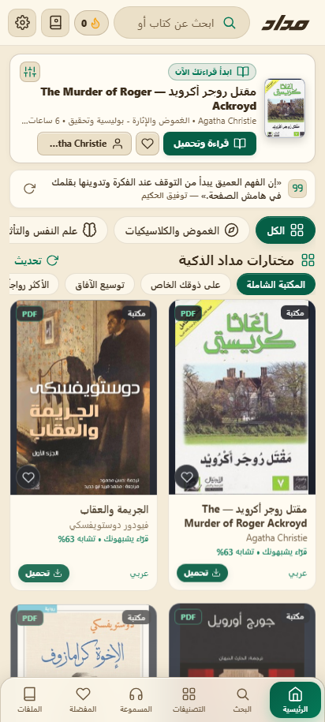
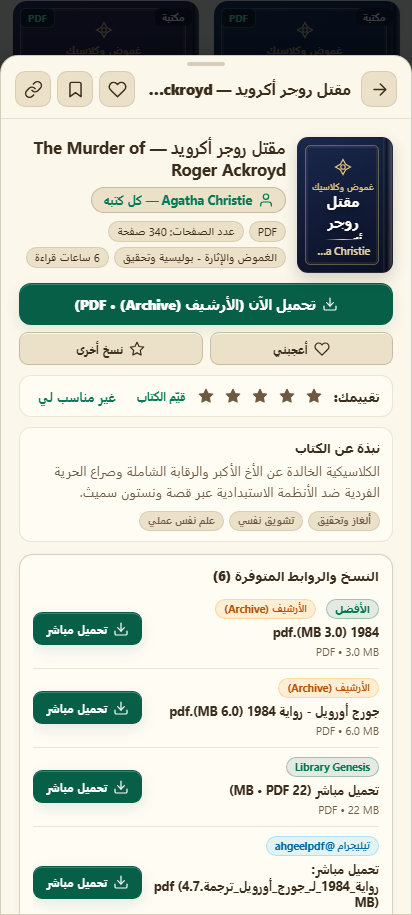
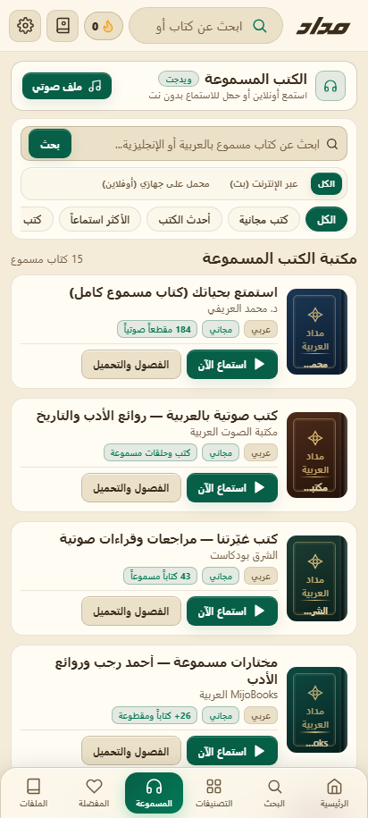
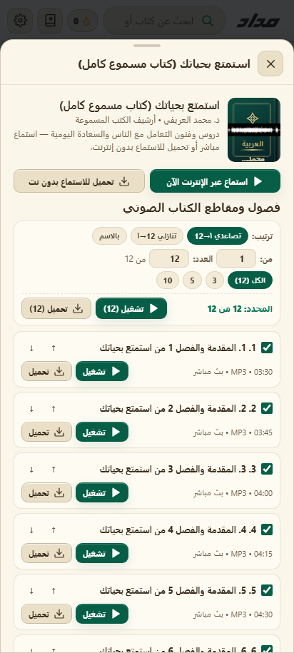

# مداد | Midad

**مكتبتك العربية والعالمية الشاملة للقراءة والاستماع — سريع، خفيف، ومصمم للتركيز.**  
*Your all-in-one Arabic & English eBook reader, audiobook player, and smart discovery library for Android.*

---

## عن تطبيق مداد (About Midad)

**مداد (Midad)** هو تطبيق أندرويد متكامل لعشّاق القراءة والكتب المسموعة، يجمع بين **البحث المباشر عبر عشرات المكتبات العربية والعالمية**، و**قارئ PDF وEPUB داخلي مريح للعين**، و**مشغّل كتب صوتية متكامل** يدعم البث عبر الإنترنت أو التحميل للاستماع بدون نت، مع محرك ترشيحات ذكي يتعلّم ذوقك الشخصي بالكامل على جهازك.

---

## أبرز المميزات

### 📚 بحث موحّد وتحميل مباشر من المكتبات الكبرى
* بحث فوري في أهم المكتبات العربية والعالمية (مكتبة نور، قهوة 8 غرب، فولة بوك، مؤسسة هنداوي، الأرشيف العالمي Archive.org، المكتبة الوقفية، قنوات الكتب، LibGen، Gutenberg، OpenLibrary، DOAB، OAPEN وغيرها).
* تجميع كل النسخ والروابط المتاحة للكتاب وترتيبها بوضوح مع خيار التحميل المباشر بنقرة واحدة إلى جهازك.
* دعم كامل لملفات `PDF` و`EPUB` و`AZW3` وفتح كتب جهازك المحلية تلقائياً في مكان واحد.

### 📖 قارئ داخلي متقدم ومريح للعين
* يفتح افتراضياً على **وضع الورق الدافئ (Sepia)** لتقليل إجهاد العين أثناء القراءة الطويلة، مع دعم الوضع **الداكن** و**النهاري** و**المريح**.
* أدوات قراءة وتفاعل متكاملة: **القلم والرسم الحر، الماركر وتظليل السطور، الإشارات المرجعية، فهرس الفصول، والترجمة الفورية**.
* حفظ تلقائي لآخر صفحة وصلت إليها مع خيار **فتح آخر كتاب تلقائياً** عند تشغيل التطبيق لاستكمال القراءة فوراً.

### 🎧 قسم الكتب المسموعة + ويدجت الشاشة الرئيسية
* استماع مباشر عبر الإنترنت أو **تحميل الفصول للاستماع أوفلاين بدون إنترنت**.
* تحديد نطاق الفصول وترتيبها، التحكم في سرعة التشغيل (`0.5x` حتى `2.0x`)، ومؤقت النوم (`Sleep Timer`).
* شريط تشغيل مصغّر مستمر و**ويدجت خارجية أنيقة للشاشة الرئيسية** بألوان متجددة.

### ✨ ذكاء ترشيحات محلي وعادة القراءة اليومية
* محرك ترشيحات ذكي يعمل محلياً على جهازك (`على ذوقك الخاص` • `توسيع الآفاق` • `الأكثر رواجاً`).
* عرض **آراء وتقييمات القراء الحقيقية** من المصادر العالمية والعربية.
* نظام **مهمة القراءة اليومية وسلسلة الأيام (Streak)** متاح من أيقونة الشعلة العلوية وويدجت خاص لمتابعة هدفك اليومي.

---

## لقطات من داخل التطبيق

| الواجهة الرئيسية وتصفح الكتب | صفحة الكتاب وروابط التحميل | قسم الكتب المسموعة | فصول الكتاب الصوتي |
| :---: | :---: | :---: | :---: |
|  |  |  |  |

---

## طريقة التحميل والتثبيت

1. انتقل إلى صفحة أحدث إصدار عبر الزر أعلاه أو من هنا:  
   👉 **[تحميل Midad.apk (أحدث إصدار)](https://github.com/drmvstafa/Midad-Releases/releases/latest)**
2. افتح ملف `Midad.apk` على هاتفك أو التابلت.
3. إذا طُلب منك، اسمح بالتثبيت من هذا المصدر (*Install unknown apps*) ثم اضغط **تثبيت (Install)**.
4. يتطلب نظام **Android 7.0 (API 24)** أو أحدث.

---

## المطور والدعم (Developer & Support)

* **تطوير:** **Mostafa Mostafa**
* **للتواصل والاقتراحات:** متاح مباشرة من داخل التطبيق عبر نافذة **About Midad** (بالضغط على كلمة *مداد* في الشريط العلوي):
  * WhatsApp: `+201027608911`
  * Instagram: `m.o.s.9.a.f.a`
  * Donate (InstaPay): `01027608911` *(مباشرة من زر Donate داخل التطبيق)*
